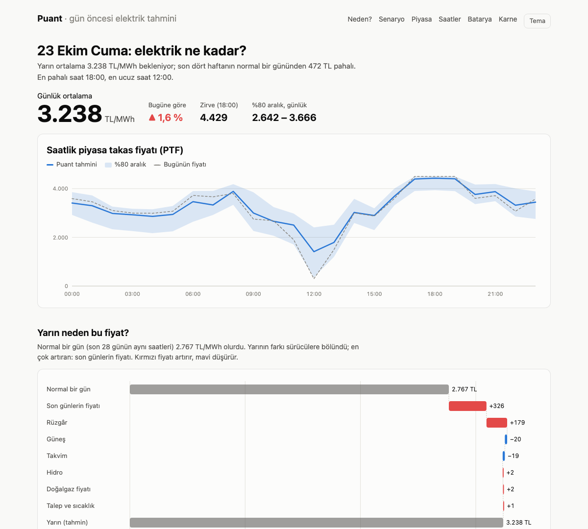

# Puant

**Day-ahead probabilistic forecasts for the Turkish electricity market, with the reasons behind
them, tested the way they would have been used.**

*Puant* is Turkish for the evening peak hour, when the grid is under the most pressure. Every morning, before the
day-ahead market closes at 12:30, Puant forecasts tomorrow's hourly **market clearing price
(PTF)**, **consumption**, **wind** and **solar** generation and the grid's **carbon intensity**,
each as a 10–50–90 % range. It then explains *why* tomorrow's price is high or low, lets you rerun it
under different weather, and simulates the auction on EPİAŞ's real supply and demand curves.



## Results

Rolling backtest from July 2024 to October 2026 (20,000+ hours). The models were retrained on
the first of every month using only data before that day, and every day was forecast with the
**weather forecast issued the day before**, never the weather that actually happened. The benchmark is
the best official or simple forecast available at the same time.

| Forecast | Puant error (MAE) | Best benchmark | Benchmark error | Improvement | 80 % band held |
|---|---|---|---|---|---|
| Price | 311 TL/MWh | same hour today | 433 | **28 %** | 79 % |
| Consumption | 893 MWh | TEİAŞ load plan | 1,185 | **25 %** | 80 % |
| Wind | 656 MWh | EPİAŞ wind forecast | 1,000 | **34 %** | 77 % |
| Solar (licensed) | 108 MWh | same hour last week | 200 | **46 %** | 76 % |
| Carbon intensity | 22 g/kWh | same hour last week | 38 | **43 %** | 79 % |

**What it is worth.** A 10 MWh / 5 MW battery (90 % round trip) that planned each day on Puant's
median price forecast and was paid actual prices would have earned **15.4 million TL** over 844
days: **82 %** of what perfect foresight could have earned, and **2.0×** a fixed "charge late
morning, discharge in the evening" rule.

## What the dashboard shows

- **Tomorrow's prices** with an 80 % band, against today's prices.
- **Why tomorrow costs what it does.** The gap between tomorrow and a *normal day* (the last 28
  days at the same hour) is split among wind, demand and temperature, sun, gas, hydro, calendar and
  recent prices with **exact Shapley values** over the groups. The parts add up to the gap, and
  no group takes credit for another's effect.
- **What if.** Tomorrow's price with temperature shifted ±4 °C (the consumption model moves demand
  with it), wind ±50 % and gas ±20 %.
- **Market simulator.** EPİAŞ publishes the aggregate supply and demand curves of every hourly auction.
  Their crossing reproduces the actual clearing price exactly in most hours (within a few percent
  otherwise: block bids are not in the curves). Shifting a curve answers questions such as
  "2,000 MW less wind" directly from real bids, price cap included.
- **Cheapest and cleanest hours** for flexible demand such as an EV, a washing machine or an industrial load.
- **The battery** plan for tomorrow and its backtested earnings.
- **A scoreboard** of the backtest and of every live forecast, graded once the day is over. Only
  forecasts made before the 12:30 market close count.

## How it works

**Information set.** The forecast for day D+1 is made on the morning of D. Day D's prices are known
(published on D−1); consumption and generation are known up to the morning of D, so their lags
start at D−1. TEİAŞ's load plan and EPİAŞ's wind forecast for D+1 are published before the market closes.
A test rewrites a forecast day's own prices, consumption and generation and checks that none of
its features change.

**Data.** [EPİAŞ Transparency Platform](https://seffaflik.epias.com.tr) (prices, real-time
consumption and generation by source, load plan, wind forecast, gas reference price) and
[Open-Meteo](https://open-meteo.com) (ERA5 reanalysis, and archived day-ahead forecasts from their
previous-runs API). Temperature is weighted by the population of 26 provinces. Wind at hub height and
solar irradiance are weighted by the installed capacity of wind and solar farms mapped in
[OpenStreetMap](https://www.openstreetmap.org), clustered into 12 sites each
(`scripts/build_sites.py`). Wind speed is turned into a turbine power curve before averaging.

**Models.** One histogram gradient-boosting model per target and quantile (scikit-learn). Three
choices make them hold up out of sample:

- *Prices relative to their recent level.* Lira prices rose roughly tenfold over 2019–2022, so the
  target and the price features are ratios to the mean price of the last 28 days.
- *Output per unit of weather for wind and solar.* Grid-connected solar nearly tripled since 2023 and
  trees cannot extrapolate. The models forecast output divided by the recent yield (MWh per unit
  of irradiance or wind power index over the last 2–4 weeks), which carries capacity growth
  forward automatically. This alone cut the solar error from 490 to 108 MWh.
- *Official forecasts as inputs.* The consumption model sees TEİAŞ's load plan and the wind model sees
  EPİAŞ's forecast, and both learn to correct them.

**Calibrated bands.** Quantile models trained on reanalysis weather are overconfident when fed a
forecast. Training on archived day-ahead forecasts where they exist, plus split-conformal scaling on
the last 90 days of out-of-sample errors, brings the 80 % bands to 76–80 % coverage.

**Carbon.** Hourly intensity of domestic generation from the fuel mix (IPCC fuel factors over
typical plant efficiencies; Turkish geothermal counted at 0.38 t/MWh for its reservoir CO₂).
The result, about 470 g/kWh on average, is in line with published estimates (Ember).

## Limitations

- The explanation is the model's view: which inputs moved *its* forecast. It is not a causal
  claim about the market.
- "Solar" is the real-time measured, licensed generation that EPİAŞ publishes. Rooftop and unlicensed
  plants appear only as lower consumption.
- Carbon intensity covers direct emissions of domestic generation. Imports and life-cycle
  emissions are excluded.
- The simulator uses the published aggregate curves. Block and flexible bids are not in them, and
  shifting a curve assumes everyone else bids the same.
- Not investment or trading advice.

## Running it

```bash
pip install -e ".[model,dev]"
cp .env.example .env              # add your EPİAŞ Transparency Platform login
python -m puant.data --weather    # history since 2019 (weather since 2021), ~20 MB
python -m puant.backtest          # the rolling backtest (~20 min on 10 cores)
python -m puant.live              # tomorrow's forecast -> site/data/*.json
python -m http.server -d site     # the dashboard
pytest
```

The Transparency Platform API needs a free EPİAŞ account. The credentials are read
from `.env` locally and from repository secrets in CI, and never enter git.

**Automation.** `.github/workflows/daily.yml` runs at 09:30 Turkish time. It restores the raw data
from the Actions cache, updates it, forecasts tomorrow, commits the forecast to `data/forecasts/`
for the live scoreboard, and deploys the dashboard to GitHub Pages. `backtest.yml` reruns the
backtest every month. Set `EPIAS_USERNAME` and `EPIAS_PASSWORD` as repository secrets.

## Layout

```
src/puant/
  epias.py      EPİAŞ client (login ticket, chunking, throttling)
  weather.py    Open-Meteo: population- and capacity-weighted drivers
  data.py       incremental parquet store
  calendar.py   holidays, Bayram eves, bridge days
  features.py   as-of-morning features and targets
  models.py     quantile models, rolling backtest, conformal bands
  explain.py    Shapley attribution, scenario grid
  market.py     auction simulator on supply/demand curves
  battery.py    battery arbitrage (dynamic programming)
  carbon.py     carbon intensity, best hours
  live.py       tomorrow's forecast for the dashboard
site/           static dashboard (no dependencies)
```

## Data and licences

EPİAŞ Transparency Platform data is public. Weather data © Open-Meteo, CC BY 4.0 (ERA5:
Copernicus Climate Change Service). Plant locations © OpenStreetMap contributors, ODbL.
